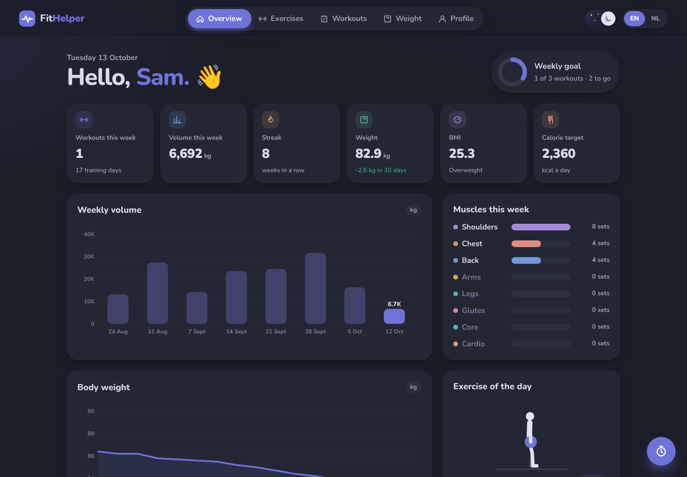
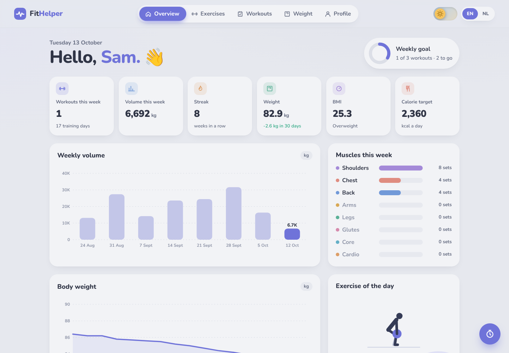
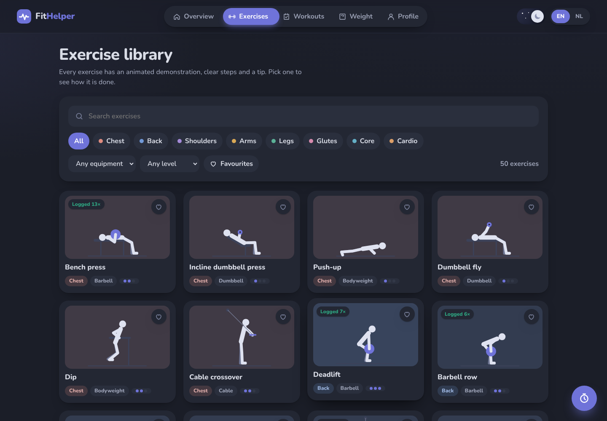
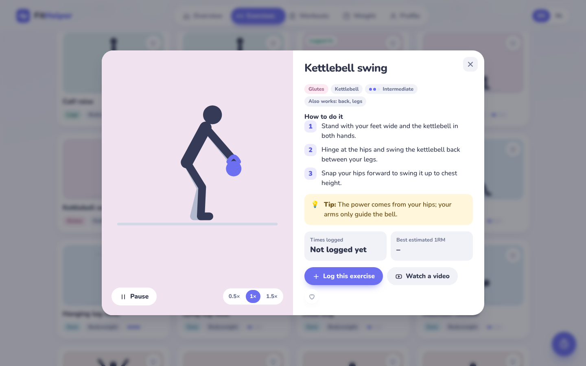
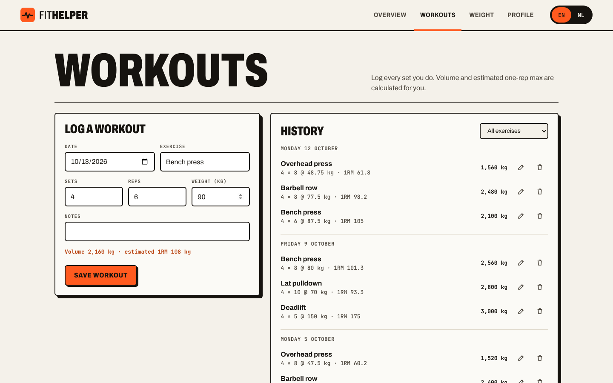
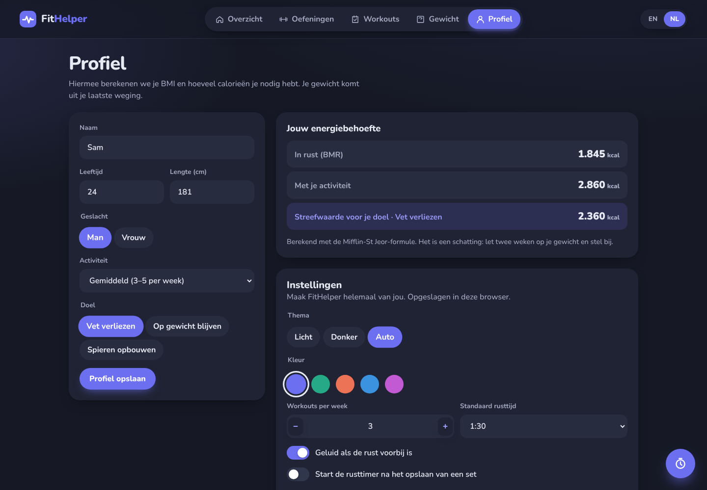
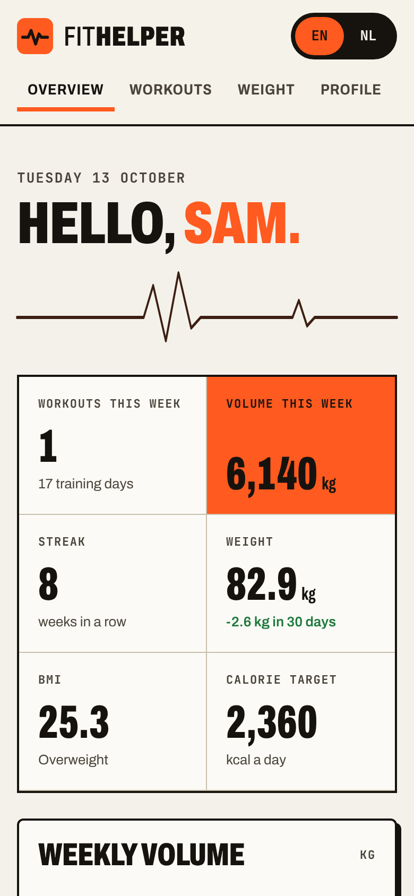

# FitHelper

Track your workouts, body weight and progress, and learn new exercises from an animated library. A **FastAPI** backend with a SQLite database, and a web dashboard in plain JavaScript that talks to the same REST API. The dashboard switches between English and Dutch, and between a light and a dark theme.

This is version 2 of [FitHelper](https://github.com/AhmetR42/Fithelper-App), which started as a Python console app. Data from the console app can be imported (see below).

**Live demo:** [fithelper-3n3w.onrender.com](https://fithelper-3n3w.onrender.com/) (free hosting, so the first visit can take about a minute to wake up; press "Load example data" to try it right away)



<details><summary>Light theme</summary>



</details>

## Features

- **Exercise library**: 50 exercises in the database, each with an animated demonstration, three steps in English and Dutch, a tip, the muscles it works and a link to a video. Search, filter by muscle group, equipment and level, and keep favourites.
- **Animated figures**: every demonstration is drawn in SVG by a small animation engine (`static/js/demos.js`). Poses are keyframes; elbows and knees are placed with two-bone inverse kinematics, so feet stay on the floor and hands stay on the bar.
- **Workout log**: exercise, sets, reps, weight and notes. Volume and estimated one-rep max (Epley) are calculated for every set. Edit, delete and undo.
- **Weekly overview**: a weekly goal ring, workouts and volume this week, training streak in weeks, which muscle groups you trained, an exercise of the day and a bar chart of the last eight weeks.
- **Rest timer** with presets, +15 seconds, a sound and vibration when the rest is over, and an option to start it after every set.
- **Celebrations**: confetti for a new personal record or a reached weekly goal.
- **Dark mode by default**, with an animated sun and moon switch in the top bar; the new theme grows as a circle from the switch.
- **Settings**: light, dark or automatic theme, five accent colours, weekly goal, default rest time, sound and calm mode with fewer animations.
- **Personal records** per exercise, and a progress chart for any exercise.
- **Body weight**: one weigh-in per day, a line chart, and the change over the last 30 days.
- **Profile and calories**: BMI with its category, and daily calories with the Mifflin-St Jeor formula, adjusted for activity level and goal (lose fat, maintain, build muscle).
- **English and Dutch** with an animated toggle. The choice is remembered.
- **Validation** on the server. When a form is rejected, the dashboard highlights the fields the API complained about.
- **Example data** with one click, so you can try the dashboard right away.

| Exercise library | Exercise details |
| --- | --- |
|  |  |

| Workouts and rest timer | Profile and settings (Dutch) |
| --- | --- |
|  |  |

<p align="center"></p>

## Run it

### With Docker

```bash
docker compose up --build
```

Open http://localhost:8000. The database is kept in a Docker volume.

Is port 8000 already in use? Pick another one, for example `PORT=8080 docker compose up --build` (PowerShell: `$env:PORT=8080; docker compose up --build`), and open http://localhost:8080.

### Online (free)

[](https://render.com/deploy?repo=https://github.com/AhmetR42/FitHelper)

The repository contains a `render.yaml`, so Render builds the Docker image and gives the app a public address. On the free plan the app sleeps after a while without visitors (the first visit then takes about a minute) and the database starts empty after every restart.

### With Python

Requires Python 3.12 or newer.

```bash
python -m venv .venv
source .venv/bin/activate          # Windows: .venv\Scripts\activate
pip install -r requirements-dev.txt
uvicorn app.main:app --reload
```

Open http://localhost:8000 and click **Load example data**, or run `python -m app.seed`.

The interactive API documentation is at http://localhost:8000/docs.

## API

| Method | Path | What it does |
| --- | --- | --- |
| `GET` / `PUT` | `/api/profile` | Read or save the profile |
| `GET` | `/api/workouts` | List workouts. Filters: `exercise`, `from`, `to`, `limit` |
| `POST` | `/api/workouts` | Log a workout |
| `PUT` / `DELETE` | `/api/workouts/{id}` | Change or delete a workout |
| `GET` | `/api/workouts/exercises` | All exercise names used so far |
| `GET` / `POST` | `/api/weights` | List weigh-ins or add one (one per day) |
| `DELETE` | `/api/weights/{id}` | Delete a weigh-in |
| `GET` | `/api/exercises` | The exercise library. Filters: `muscle`, `equipment`, `level`, `q`, `favorites` |
| `GET` | `/api/exercises/{slug}` | One exercise with steps, tip and how often you logged it |
| `PUT` | `/api/exercises/{slug}/favorite` | Mark or unmark a favourite |
| `GET` | `/api/stats/summary` | Everything the overview page shows |
| `GET` | `/api/stats/exercise/{name}` | Best estimated 1RM per day for one exercise |
| `POST` | `/api/demo` | Replace all data with example data |

Example:

```bash
curl -X POST http://localhost:8000/api/workouts \
  -H "Content-Type: application/json" \
  -d '{"date": "2026-10-13", "exercise": "Bench press", "sets": 4, "reps": 6, "weight_kg": 90}'
```

## Import data from the console app

The first FitHelper saved its data in `data/user.json`, `data/workouts.json` and `data/weights.json`. Point the import script at that folder:

```bash
python -m app.import_v1 path/to/Fithelper-App/data
```

## Tests

```bash
pytest          # calculations, the exercise library and every API endpoint
ruff check .    # lint
```

The tests use an in-memory SQLite database and a fixed date, so they give the same result every day. GitHub Actions runs the linter and the tests, then builds the Docker image and checks that the app answers.

## Project structure

```
app/
  main.py          FastAPI app, routes are registered here
  fitness.py       BMI, calories, volume, 1RM, streaks (pure functions)
  models.py        database tables (SQLModel)
  schemas.py       request and response models
  library.py       the exercise library, copied into the database on startup
  routers/         profile, workouts, weights, stats, exercises
  seed.py          example data
  import_v1.py     import from the console app
static/            dashboard: HTML, CSS and JavaScript modules
  js/demos.js      the animated exercise figures
tests/             pytest
```

## Built with

Python 3.13, FastAPI, SQLModel (SQLAlchemy + Pydantic), SQLite, pytest, Ruff, Docker, and vanilla JavaScript with hand-drawn SVG charts and animations.

## License

[MIT](LICENSE)
